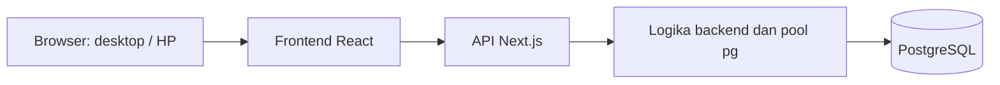

# SOUV — Souvenir Tracking

Aplikasi pencatatan stok dan distribusi souvenir untuk tim funding. Kelola barang masuk, pemberian kepada nasabah, dan riwayat transaksi melalui satu ruang kerja yang dapat diakses dari desktop maupun HP.

**Next.js 16 · React 19 · TypeScript · Tailwind CSS 4 · PostgreSQL**

Ditujukan untuk uji coba internal terkontrol. Panduan pengembangan, pengujian, dan pemulihan tersedia di repo ini.

[Fitur](#fitur) · [Instalasi](#instalasi) · [Perintah](#perintah) · [Verifikasi](#kualitas-dan-verifikasi) · [Panduan pengembangan](src/README.md) · [Operasional](docs/OPERATIONS.md)

## Fitur

- **Pengelolaan souvenir** — daftar produk, foto, kategori, satuan, stok minimum, arsip, serta penghapusan produk tanpa stok dan riwayat.
- **Pencatatan stok** — penerimaan barang, pemberian kepada nasabah, penyesuaian stok fisik, dan pembatalan transaksi dengan alasan.
- **Label dan pemindaian QR** — buat label produk, buka form melalui tautan QR, atau pindai menggunakan kamera HP.
- **Riwayat aktivitas** — pencarian dan filter tanggal, jenis, barang, serta petugas diproses di server, dengan tampilan per halaman.
- **Ekspor Excel** — unduh seluruh hasil filter riwayat, termasuk transaksi lama di luar 5.000 catatan terbaru, atau register stok dengan rekap dan sheet per barang.
- **Ringkasan bulanan** — total barang masuk dan pemberian dihitung dari database menggunakan batas tanggal WIB.
- **Akses berdasarkan peran** — admin mengelola produk dan akun; anggota mencatat transaksi serta melihat riwayat miliknya.
- **Pengelolaan password** — pengguna mengganti password melalui aplikasi; operator dapat memulihkan akun yang lupa password. Pergantian password mencabut sesi lama.

### Hak akses

| Aktivitas | Admin | Anggota |
| --- | :---: | :---: |
| Melihat stok dan mencatat barang masuk/pemberian | Ya | Ya |
| Melihat dan mengekspor riwayat | Seluruh tim | Milik sendiri |
| Mengelola produk dan akun | Ya | — |
| Menyesuaikan stok dan membatalkan transaksi | Ya | — |
| Mengekspor register stok seluruh barang | Ya | — |
| Mengubah password sendiri | Ya | Ya |

Pemulihan password melalui terminal memerlukan akses operator database, terpisah dari peran pengguna aplikasi.

## Arsitektur

Frontend dan backend berada dalam **satu aplikasi Next.js**. Halaman React memanggil API aplikasi, kemudian backend membaca dan menulis data ke PostgreSQL melalui driver `pg` dengan pool koneksi.



| Bagian | Lokasi | Tanggung jawab |
| --- | --- | --- |
| Frontend | [src/app/page.tsx](src/app/page.tsx), [src/components/](src/components/) | Dashboard, form transaksi, riwayat, dan scanner QR. |
| Styling | [src/app/globals.css](src/app/globals.css), [src/app/theme.css](src/app/theme.css) | Tema dan tata letak responsif. |
| Backend / API | [src/app/api/](src/app/api/), [src/lib/](src/lib/) | Dispatcher API, modul autentikasi, akun, riwayat, validasi, dan operasi workspace. |
| Akses database | [src/lib/local-db.mjs](src/lib/local-db.mjs) | Query berparameter dan pool koneksi PostgreSQL. |
| Schema database | [src/db/migrations/](src/db/migrations/) | Tabel, constraint, dan fungsi transaksi stok. |

Ekspor Excel dan pembuatan label QR dijalankan di browser. Stok dan riwayat ditulis secara atomik melalui fungsi SQL, dengan penguncian produk dan identitas permintaan untuk mencegah pencatatan ganda saat retry. Akun database aplikasi dibatasi; kredensial admin untuk migrasi dan pemulihan disimpan terpisah.

Pembagian modul frontend dan backend dijelaskan di [panduan pengembangan](src/README.md#peta-kode).

## Struktur proyek

```text
.
├── .github/workflows/       Pemeriksaan otomatis di GitHub Actions
├── docs/OPERATIONS.md       Upgrade, backup, restore, dan pemulihan akun
├── src/
│   ├── app/                 Halaman, stylesheet, dan API routes Next.js
│   ├── components/          Workspace, form, scanner, dan komponen UI
│   ├── lib/                 Logika backend, aturan domain, dan ekspor
│   ├── db/migrations/       Migrasi SQL berurutan
│   ├── public/fonts/        Font lokal beserta lisensinya
│   ├── scripts/             Setup, pengujian, backup, restore, dan pratinjau
│   ├── tests/               Unit test, integrasi database, dan tes browser
│   ├── .env.example         Templat konfigurasi lokal
│   ├── package.json         Perintah dan dependensi aplikasi
│   └── README.md            Panduan teknis
├── package.json             npm workspace dan pintasan perintah
├── package-lock.json        Versi dependensi untuk instalasi konsisten
├── .gitignore               Aturan berkas yang tidak disertakan Git
└── README.md
```

Konfigurasi Next.js, TypeScript, PostCSS, dan Playwright berada di `src/`. Seluruh contoh perintah di bawah dijalankan dari **direktori utama repo**.

## Instalasi

### Prasyarat

- **Node.js 22 atau lebih baru** dan npm. Workflow CI dikonfigurasi untuk Node.js 22 dan 24.
- **PostgreSQL**. Setup cluster lokal otomatis membutuhkan `psql`, `initdb`, `pg_ctl`, dan `createdb`; konfigurasi bawaan mengarah ke PostgreSQL 18 pada Windows. Server PostgreSQL yang sudah tersedia dapat digunakan melalui koneksi admin saat setup.
- **`pg_dump` dan `pg_restore`** untuk backup dan pemulihan; keduanya tersedia dalam instalasi PostgreSQL.

Pada Windows PowerShell yang memblokir `npm.ps1`, gunakan `npm.cmd` sebagai pengganti `npm`.

### 1. Instal dependensi

Setelah mengunduh atau melakukan clone repo, buka terminal pada direktori utama:

```sh
npm ci
```

### 2. Siapkan konfigurasi

Salin [src/.env.example](src/.env.example) menjadi `src/.env.local`. Pada PowerShell:

```powershell
Copy-Item src/.env.example src/.env.local
```

Lakukan langkah ini pada instalasi baru; pertahankan konfigurasi yang sudah ada jika aplikasi pernah disiapkan. Sesuaikan `POSTGRES_BIN` dengan folder `bin` PostgreSQL di komputer Anda.

```dotenv
POSTGRES_BIN=C:/Program Files/PostgreSQL/18/bin
DATABASE_URL=
APP_PUBLIC_ORIGIN=
SEED_DEMO_DATA=0
```

Jika `DATABASE_URL` kosong, setup membuat cluster khusus proyek pada `127.0.0.1:55432` dengan database `souvenir_tracking`. Untuk memakai server PostgreSQL yang sudah tersedia, tetapkan `DATABASE_ADMIN_URL` pada terminal operator sebelum setup; lihat [panduan operasional](docs/OPERATIONS.md).

### 3. Siapkan database dan jalankan aplikasi

```sh
npm run db:setup
npm run db:check
npm run dev
```

Buka **http://localhost:3000**. Setup awal membuat akun admin. Akun anggota dan stok contoh hanya dibuat jika `SEED_DEMO_DATA=1`; biarkan `0` untuk database operasional baru. Email dan password awal tersimpan di `src/.env.local`; password dibuat otomatis jika belum diisi dan tidak dicetak ke terminal.

Setelah setup, `src/.env.local` berisi koneksi database aplikasi dengan izin terbatas. Kredensial admin database berada di `.local/database-admin.env`. Mengubah password awal di environment setelah akun dibuat tidak mengganti password akun; gunakan menu **Ubah password** atau perintah pemulihan akun.

Untuk memperbarui instalasi yang sudah memiliki data, ikuti [panduan upgrade](docs/OPERATIONS.md#instalasi-dan-upgrade) dan buat backup sebelum menjalankan migrasi.

### Pratinjau tanpa database

Untuk melihat tampilan dengan data contoh setelah dependensi terpasang:

```sh
npm run preview:demo
```

Buka **http://localhost:3000**. Perubahan dalam mode ini tidak disimpan. Decoder QR cadangan tidak disertakan pada server pratinjau; gunakan aplikasi Next.js untuk dukungan pemindaian lengkap.

## Perintah

Jalankan dari direktori utama repo. `package.json` meneruskan perintah ke aplikasi dalam `src/`.

| Perintah | Kegunaan |
| --- | --- |
| `npm run dev` | Menjalankan server pengembangan Next.js. |
| `npm run build` | Membuat build produksi. |
| `npm start` | Menjalankan hasil build produksi. |
| `npm run typecheck` | Menghasilkan tipe route Next.js, lalu memeriksa TypeScript dan modul JavaScript yang memakai `@ts-check`. |
| `npm test` | Menjalankan unit test tanpa database. |
| `npm run db:setup` | Menyiapkan database, menerapkan migrasi, dan membuat akun runtime terbatas. |
| `npm run db:start` | Alias `db:setup`, termasuk penerapan migrasi. |
| `npm run db:check` | Memeriksa koneksi, kesiapan schema, dan izin akun runtime. |
| `npm run db:test:setup` | Menyiapkan database pengujian terpisah. |
| `npm run test:db` | Menjalankan tes integrasi PostgreSQL dengan akun runtime terbatas. |
| `npm run db:backup` | Membuat backup database tanpa menimpa file. |
| `npm run test:e2e` | Menjalankan tes browser desktop dan HP. |
| `npm run preview:demo` | Pratinjau dengan data contoh tanpa database. |
| `npm run local` | Server lokal alternatif dengan handler API yang sama. |

Untuk build produksi:

```sh
npm run build
npm start
```

Database harus tetap berjalan. Perintah restore dan pemulihan akun memerlukan argumen:

```sh
npm run db:restore -- --file .local/backups/sebelum-upgrade.dump --database souvenir_restore_20261116
npm run account:reset -- --email admin@funding.local
```

Restore membuat database baru dan menolak menimpa database yang sudah ada. Penjelasan kredensial operator dan langkah verifikasi tersedia di [panduan operasional](docs/OPERATIONS.md).

## Kualitas dan verifikasi

Pemeriksaan dasar:

```sh
npm run typecheck
npm test
npm run build
```

Pengujian database dan browser:

```sh
npm run db:test:setup
npm run test:db
npx playwright install chromium
npm run test:e2e
```

Tes integrasi memakai `src/.env.test.local` dan menolak nama database yang tidak berakhir `_test`. Playwright menjalankan server tersendiri pada port **3100**. Rincian konfigurasi serta cakupan tes ada di [panduan pengembangan](src/README.md#pengujian).

Hasil verifikasi lokal terakhir pada **16 November 2026**, menggunakan Node.js 24.15.0:

| Pemeriksaan | Hasil |
| --- | --- |
| Instalasi dari lockfile (`npm ci`) | Berhasil |
| Typecheck dan build produksi | Lolos |
| Unit test | 18 lolos |
| Tes integrasi PostgreSQL | 15 lolos, termasuk pengujian induk |
| Tes browser desktop dan HP | 34 lolos |
| Audit npm | 0 kerentanan yang dilaporkan saat pemeriksaan |
| Backup dan restore | Berhasil; total produk, transaksi, stok, dan foto cocok dengan sumber |

[Workflow CI](.github/workflows/ci.yml) dikonfigurasi untuk menjalankan typecheck, unit test, build, audit dependensi, integrasi PostgreSQL, dan tes browser pada push serta pull request. Hasil lokal di atas bukan status GitHub Actions; periksa hasil workflow pada commit yang akan dirilis.

Pemakaian produksi tetap memerlukan validasi di lingkungan deployment, pengelolaan HTTPS, jadwal backup, dan pemantauan layanan sesuai [panduan operasional](docs/OPERATIONS.md).

## Catatan penggunaan

- **Koneksi database:** aplikasi memakai driver `pg`; PostgreSQL lokal dan server PostgreSQL yang dikonfigurasi didukung. `psql` diperlukan untuk migrasi, bukan query aplikasi. Menjalankan aplikasi memerlukan proses Node.js dan PostgreSQL yang dapat dijangkau, termasuk saat menggunakan build produksi.
- **Kamera HP:** pemindaian tersedia pada viewport maksimal 720 px dan membutuhkan HTTPS atau localhost serta izin kamera. Desktop menggunakan form pemilihan barang.
- **Tautan QR:** membuka atau memindai QR memilih produk dan tindakan; stok baru berubah setelah form dikonfirmasi.
- **Waktu:** filter tanggal dan ekspor menggunakan zona waktu WIB.
- **Migrasi:** tambahkan berkas migrasi baru untuk perubahan database. Setup memeriksa checksum migrasi yang sudah diterapkan.

## Berkas lokal

`arsip-lokal/` menampung cache, bundle pratinjau, hasil tes, serta arsip pengembangan. `.local/` menampung cluster PostgreSQL, kredensial admin, backup, dan file pemulihan akun. Kedua folder tersebut diabaikan Git.

`node_modules/`, hasil build, `src/.env.local`, `src/.env.test.local`, dan kredensial admin di `.local/database-admin.env` juga diabaikan Git. Konfigurasi yang dibagikan melalui repo adalah `src/.env.example`, tanpa password.

Dependensi dikelola sebagai npm workspace dengan satu lockfile di root. Berkas tipe Next.js `src/next-env.d.ts` dibuat otomatis oleh `typecheck`, `dev`, atau `build`, dan diabaikan Git. Lisensi font lokal tersedia di [DM-Sans-LICENSE.txt](src/public/fonts/DM-Sans-LICENSE.txt).
