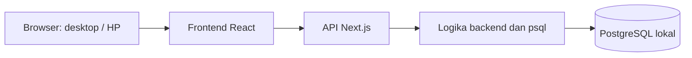

# SOUV — Souvenir Tracking

Aplikasi pencatatan stok dan distribusi souvenir untuk tim funding. Kelola barang masuk, pemberian kepada nasabah, dan riwayat transaksi melalui satu ruang kerja yang dapat diakses dari desktop maupun HP.

**Next.js 16 · React 19 · TypeScript · Tailwind CSS 4 · PostgreSQL**

[Fitur](#fitur) · [Arsitektur](#arsitektur) · [Struktur proyek](#struktur-proyek) · [Instalasi](#instalasi) · [Panduan pengembangan](src/README.md)

## Fitur

- **Pengelolaan souvenir** — daftar produk, foto, kategori, satuan, stok minimum, serta arsip produk.
- **Pencatatan stok** — penerimaan barang, pemberian kepada nasabah, penyesuaian stok fisik, dan pembatalan transaksi dengan alasan.
- **Label dan pemindaian QR** — buat label produk, buka form melalui tautan QR, atau pindai menggunakan kamera HP.
- **Riwayat aktivitas** — cari dan filter transaksi berdasarkan tanggal, jenis, barang, dan petugas.
- **Ekspor Excel** — unduh riwayat sesuai filter atau register stok dengan rekap dan sheet per barang.
- **Akses berdasarkan peran** — admin mengelola produk dan akun; anggota mencatat transaksi serta melihat riwayat miliknya.

### Hak akses

| Aktivitas | Admin | Anggota |
| --- | :---: | :---: |
| Melihat stok dan mencatat barang masuk/pemberian | Ya | Ya |
| Melihat dan mengekspor riwayat | Seluruh tim | Milik sendiri |
| Mengelola produk dan akun | Ya | — |
| Menyesuaikan stok dan membatalkan transaksi | Ya | — |
| Mengekspor register stok seluruh barang | Ya | — |

## Arsitektur

Frontend dan backend berada dalam **satu aplikasi Next.js**. Halaman React memanggil API aplikasi, kemudian backend membaca dan menulis data ke PostgreSQL lokal melalui `psql`.



| Bagian | Lokasi | Tanggung jawab |
| --- | --- | --- |
| Frontend | [src/app/page.tsx](src/app/page.tsx), [src/components/](src/components/) | Dashboard, form transaksi, riwayat, dan scanner QR. |
| Styling | [src/app/globals.css](src/app/globals.css), [src/app/theme.css](src/app/theme.css) | Tema dan tata letak responsif. |
| Backend / API | [src/app/api/](src/app/api/), [src/lib/local-api.mjs](src/lib/local-api.mjs) | Autentikasi, otorisasi, validasi, dan pemrosesan permintaan. |
| Akses database | [src/lib/local-db.mjs](src/lib/local-db.mjs) | Eksekusi SQL pada PostgreSQL lokal. |
| Schema database | [src/db/migrations/](src/db/migrations/) | Tabel, constraint, dan fungsi transaksi stok. |

Ekspor Excel dan pembuatan label QR dijalankan di browser. Folder `lib/` berisi fungsi bersama serta modul browser dan server; pembagian modul dijelaskan di [panduan pengembangan](src/README.md).

## Struktur proyek

```text
.
├── src/
│   ├── app/                 Halaman, stylesheet, dan API routes Next.js
│   ├── components/          Workspace, form, scanner, dan komponen UI
│   ├── lib/                 Logika backend, aturan domain, dan ekspor
│   ├── db/migrations/       Migrasi SQL berurutan
│   ├── public/fonts/        Font lokal beserta lisensinya
│   ├── scripts/             Setup database dan server pratinjau
│   ├── tests/               Unit test, integrasi database, dan tes browser
│   ├── .env.example         Templat konfigurasi lokal
│   ├── package.json         Perintah dan dependensi aplikasi
│   └── README.md            Panduan teknis
├── package.json             Pintasan perintah dari direktori utama
├── .gitignore               Aturan berkas yang tidak disertakan Git
└── README.md
```

Konfigurasi Next.js, TypeScript, PostCSS, dan Playwright berada di `src/`. Seluruh contoh perintah di bawah dijalankan dari **direktori utama repo**.

## Instalasi

### Prasyarat

- **Node.js 22 atau lebih baru** dan npm.
- **PostgreSQL lokal** dengan executable `psql`, `initdb`, `pg_ctl`, dan `createdb` untuk setup otomatis. Konfigurasi bawaan menggunakan folder instalasi PostgreSQL 18 pada Windows.

Pada Windows PowerShell yang memblokir `npm.ps1`, gunakan `npm.cmd` sebagai pengganti `npm`.

### 1. Instal dependensi

Setelah mengunduh atau melakukan clone repo, buka terminal pada direktori utama:

```sh
npm install
```

### 2. Siapkan konfigurasi

Salin [src/.env.example](src/.env.example) menjadi `src/.env.local`. Pada PowerShell:

```powershell
Copy-Item src/.env.example src/.env.local
```

Lakukan langkah ini pada instalasi baru; pertahankan konfigurasi yang sudah ada jika aplikasi pernah disiapkan. Sesuaikan `POSTGRES_BIN` dengan folder `bin` PostgreSQL di komputer Anda.

```dotenv
POSTGRES_BIN=C:/Program Files/PostgreSQL/18/bin
DATABASE_URL=
APP_PUBLIC_ORIGIN=
```

Jika `DATABASE_URL` kosong, setup membuat cluster khusus proyek pada `127.0.0.1:55432` dengan database `souvenir_tracking`. Untuk memakai database lokal yang sudah tersedia, isi URL database khusus aplikasi sebelum menjalankan setup.

### 3. Siapkan database dan jalankan aplikasi

```sh
npm run db:setup
npm run db:check
npm run dev
```

Buka **http://localhost:3000**. Setup awal membuat akun admin, akun anggota, serta produk dan stok contoh. Email dan password awal tersimpan di `src/.env.local`; password dibuat otomatis jika belum diisi dan tidak dicetak ke terminal.

### Pratinjau tanpa database

Untuk melihat tampilan dengan data contoh setelah dependensi terpasang:

```sh
npm run preview:demo
```

Buka **http://localhost:3000**. Perubahan dalam mode ini tidak disimpan. Decoder QR cadangan tidak disertakan pada server pratinjau; gunakan aplikasi Next.js untuk dukungan pemindaian lengkap.

## Build dan pengujian

| Perintah | Kegunaan |
| --- | --- |
| `npm run dev` | Menjalankan server pengembangan Next.js. |
| `npm run build` | Membuat build produksi. |
| `npm start` | Menjalankan hasil build produksi. |
| `npm run typecheck` | Memeriksa tipe TypeScript. |
| `npm test` | Menjalankan unit test tanpa database. |
| `npm run test:db` | Menjalankan tes integrasi PostgreSQL. |
| `npm run test:e2e` | Menjalankan tes browser desktop dan HP. |

Untuk build produksi, jalankan `npm run build`, kemudian `npm start`. Database harus tetap berjalan. Persiapan browser dan penggunaan database pengujian dijelaskan dalam [panduan pengembangan](src/README.md#pengujian).

## Catatan penggunaan

- **Koneksi database:** implementasi saat ini hanya menerima PostgreSQL pada host lokal dan membutuhkan executable `psql`. Menjalankan aplikasi memerlukan proses Node.js serta database lokal, termasuk saat menggunakan build produksi.
- **Kamera HP:** pemindaian tersedia pada viewport maksimal 720 px dan membutuhkan HTTPS atau localhost serta izin kamera. Desktop menggunakan form pemilihan barang.
- **Tautan QR:** membuka atau memindai QR memilih produk dan tindakan; stok baru berubah setelah form dikonfirmasi.
- **Waktu:** filter tanggal dan ekspor menggunakan zona waktu WIB.
- **Migrasi:** tambahkan berkas migrasi baru untuk perubahan database. Setup memeriksa checksum migrasi yang sudah diterapkan.

## Berkas lokal

`arsip-lokal/` menampung dokumentasi internal, backup, impor/ekspor, cache, screenshot, dan hasil pengujian. Runtime PostgreSQL tersimpan di `.local/`. Kedua folder tersebut bersifat lokal dan diabaikan Git.

`node_modules/`, hasil build, dan `src/.env.local` juga diabaikan Git. Konfigurasi yang dibagikan melalui repo adalah `src/.env.example`, tanpa password.
