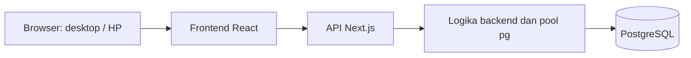
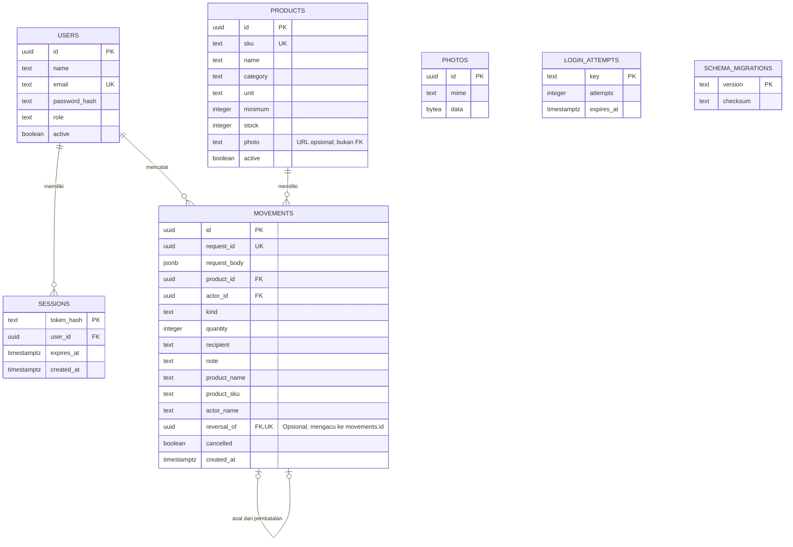
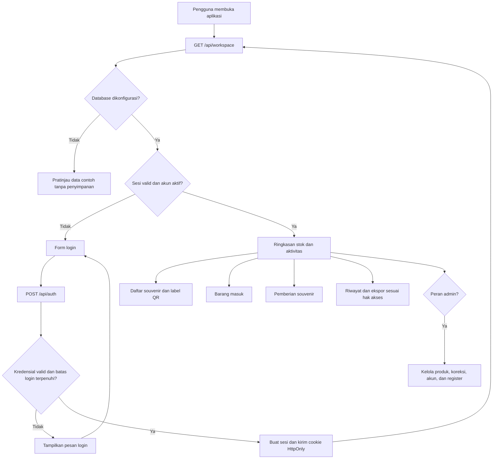
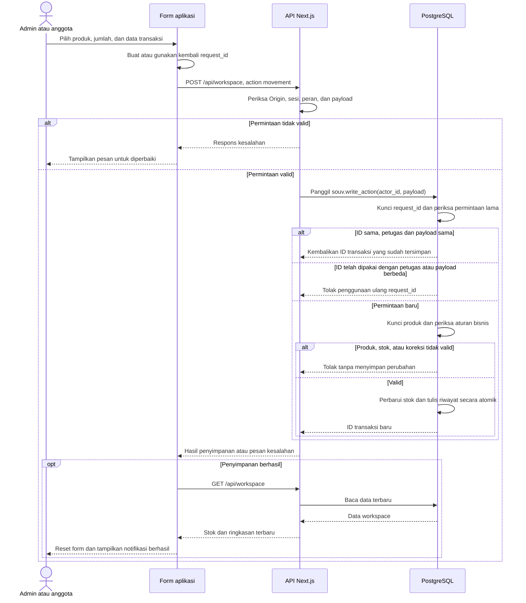

# SOUV — Souvenir Tracking

Aplikasi pencatatan stok dan distribusi souvenir untuk tim funding. Kelola barang masuk, pemberian kepada nasabah, dan riwayat transaksi melalui satu ruang kerja yang dapat diakses dari desktop maupun HP.

**Next.js 16 · React 19 · TypeScript · Tailwind CSS 4 · PostgreSQL**

Ditujukan untuk uji coba internal terkontrol. Panduan pengembangan, pengujian, dan pemulihan tersedia di repo ini.

[Fitur](#fitur) · [Hak akses](#hak-akses) · [Arsitektur](#arsitektur) · [ERD database](#erd-database) · [Alur aplikasi](#alur-aplikasi) · [Instalasi](#instalasi) · [Perintah](#perintah) · [Verifikasi](#kualitas-dan-verifikasi) · [Panduan pengembangan](src/README.md) · [Operasional](docs/OPERATIONS.md)

## Fitur

### 1. Ringkasan stok dan aktivitas

- Menampilkan total stok dan jumlah jenis souvenir aktif, jumlah barang masuk serta pemberian bulan berjalan, dan jumlah barang yang perlu perhatian.
- Menandai produk dengan stok **kurang dari atau sama dengan batas minimum**, termasuk stok habis, agar tim dapat menentukan kebutuhan pengadaan.
- Menyediakan daftar souvenir, aktivitas terbaru, dan tombol untuk memuat ulang data dari server.
- Ringkasan bulanan dihitung dari seluruh transaksi yang sesuai hak akses dalam zona waktu **WIB (`Asia/Jakarta`)**, bukan hanya aktivitas terbaru yang dimuat. Transaksi yang dibatalkan tidak dihitung sebagai penerimaan atau pemberian bulanan.
- Admin melihat ringkasan transaksi seluruh tim; anggota melihat penerimaan dan pemberian yang dicatat sendiri. Stok produk tetap merupakan stok bersama.

### 2. Pengelolaan data souvenir

- Admin dapat menambah dan mengubah nama barang, SKU, kategori, satuan, batas minimum stok, dan foto.
- SKU harus unik, maksimal 40 karakter, dan hanya berisi huruf kapital, angka, `_`, atau `-`. Backend mengubah input SKU menjadi huruf kapital.
- Foto mendukung **JPG, PNG, dan WebP maksimal 2 MiB**. Server memeriksa ukuran, MIME, dan penanda byte gambar sebelum menyimpannya di database.
- Pencarian berdasarkan nama atau SKU serta filter kategori, produk aktif, stok menipis, dan arsip dilakukan pada data produk di browser.
- Produk baru dimulai dengan stok **0**. Penambahan stok dicatat melalui transaksi agar memiliki riwayat.
- Produk hanya dapat **diarsipkan ketika stok 0** dan dapat diaktifkan kembali. Produk arsip tetap tersimpan, tetapi tidak dapat menerima transaksi atau pembatalan sebelum diaktifkan.
- Penghapusan permanen hanya diizinkan untuk produk dengan **stok 0 dan tanpa riwayat transaksi**. Produk yang sudah memiliki riwayat menggunakan arsip.

### 3. Barang masuk dan pemberian souvenir

- Admin dan anggota dapat memilih produk aktif, memasukkan jumlah, serta menambahkan catatan penerimaan atau pemberian.
- Jumlah harus berupa bilangan bulat **1–1.000.000**. Nama nasabah wajib diisi untuk pemberian.
- Penerimaan menambah stok; pemberian mengurangi stok dan ditolak jika stok terbaru tidak mencukupi.
- Identitas petugas diambil dari sesi pengguna, sedangkan waktu pencatatan dibuat oleh database.
- Setiap transaksi menyimpan nama barang, SKU, dan nama petugas saat pencatatan agar informasi historis tetap tersedia setelah data produk diubah.
- Penyimpanan stok dan riwayat berlangsung dalam satu transaksi database. Penguncian produk mencegah perubahan bersamaan memakai saldo stok yang sama; `request_id` mencegah transaksi ganda saat permintaan yang sama diulang.

### 4. Penyesuaian stok dan pembatalan

- **Penyesuaian (`adjust`)** khusus admin: masukkan stok fisik tujuan dan alasan. Sistem menyimpan selisih antara stok fisik dan stok sistem, bukan angka tujuan sebagai perubahan stok. Nilai tujuan boleh **0–1.000.000**; nilai yang sama dengan stok sistem ditolak.
- **Pembatalan (`reversal`)** khusus admin: pilih transaksi asal dan isi alasan. Sistem menambahkan transaksi dengan jumlah yang berlawanan, lalu menandai transaksi asal sebagai dibatalkan.
- Transaksi asal tetap tersimpan. Transaksi yang sudah dibatalkan dan transaksi pembatalan tidak dapat dibatalkan lagi.
- Pembatalan juga memeriksa saldo. Contohnya, penerimaan 10 unit tidak dapat dibatalkan jika stok saat ini hanya 3 unit karena akan menghasilkan stok negatif.

### 5. Label dan pemindaian QR

- Pengguna dapat membuat dan mencetak label QR dari produk serta menyalin tautan untuk membuka form **barang masuk** atau **pemberian souvenir**.
- Tautan memakai format `/?product=<UUID>&mode=in` atau `/?product=<UUID>&mode=out` pada origin aplikasi. Label lama dengan format `SOUVENIR:<UUID>` tetap diterima dengan mode pemberian.
- Saat tautan dibuka, aplikasi meminta login jika diperlukan, memeriksa produk aktif, lalu memilih produk dan form yang sesuai.
- Scanner kamera tersedia pada viewport HP maksimal **720 px** dan membutuhkan HTTPS atau localhost serta izin kamera. Aplikasi mengutamakan decoder bawaan browser dan memakai `html5-qrcode` sebagai cadangan pada mode Next.js.
- Pilihan barang manual tersedia jika kamera tidak dapat digunakan. Membuka atau memindai QR hanya memilih produk; stok berubah setelah pengguna mengonfirmasi form.

### 6. Riwayat aktivitas

- Riwayat mencakup barang masuk, pemberian, penyesuaian, dan pembatalan, beserta jumlah perubahan, barang, petugas, nasabah, catatan, dan waktu WIB.
- Pencarian nama barang, nasabah, atau petugas dapat digabungkan dengan filter rentang tanggal, jenis transaksi, produk, dan petugas.
- Filter dan pagination diproses di server. Ukuran halaman API bawaan **25 catatan**, dengan batas **1–100 catatan** per halaman; ringkasan workspace mengambil 25 aktivitas terbaru secara terpisah.
- Rentang tanggal mencakup seluruh tanggal awal dan akhir dalam WIB. Jumlah hasil dan isi halaman dibaca dari satu snapshot database.
- Admin dapat melihat seluruh tim. Anggota hanya dapat membaca riwayat miliknya, termasuk ketika mencoba mengirim filter petugas lain melalui API.

### 7. Ekspor Excel

| Jenis ekspor | Isi dan perilaku | Akses |
| --- | --- | --- |
| Riwayat aktivitas (`.xlsx`) | Seluruh hasil filter, meliputi tanggal WIB, jenis, SKU, nama barang, jumlah bertanda, petugas, nasabah, catatan, dan referensi pembatalan. Ekspor tidak terbatas pada halaman yang tampil maupun 5.000 transaksi terbaru. | Admin: seluruh tim; anggota: milik sendiri. |
| Register stok (`.xlsx`) | Sheet **Rekap** dan satu sheet per barang, termasuk barang arsip. Berisi stok awal, tambahan masuk, keluar, koreksi, saldo berjalan, petugas, dan catatan. | Admin. |

Register mengambil produk dan seluruh riwayat dari satu snapshot database. Stok awal register berasal dari seluruh penerimaan pada hari penerimaan pertama tiap barang dalam WIB; penerimaan pada hari berikutnya menjadi tambahan stok. Transaksi asal dan pembatalannya tetap ditampilkan, dengan pembatalan masuk sebagai koreksi. Sebelum berkas dibuat, saldo hasil seluruh riwayat harus cocok dengan stok produk; ekspor ditolak jika tidak cocok. Berkas Excel dirangkai di browser setelah data diperoleh dari API.

### 8. Akun tim dan keamanan akses

- Admin dapat membuat akun dengan peran `admin` atau `member`, lalu mengaktifkan atau menonaktifkan akun lain. Admin tidak dapat menonaktifkan akun sendiri.
- Penonaktifan akun mencabut sesinya. Status aktif juga diperiksa pada setiap permintaan API yang memerlukan autentikasi.
- Pengguna dapat mengganti password dengan memasukkan password saat ini dan konfirmasi password baru. Password baru harus **12–128 karakter** dan berbeda dari password saat ini.
- Setelah pergantian password, seluruh sesi lama dicabut dan perangkat yang melakukan perubahan menerima sesi baru. Operator dapat memulihkan akun melalui `account:reset` jika pengguna lupa password.
- Password disimpan sebagai hash **scrypt** dengan salt acak. Token sesi dikirim melalui cookie `HttpOnly`, `SameSite=Lax`, ditambah `Secure` pada HTTPS; database hanya menyimpan hash token. Sesi berlaku **7 hari**.
- Percobaan login dibatasi hingga **10 percobaan per jendela 15 menit** berdasarkan hash email; penghitung dihapus setelah login berhasil.
- Backend dan fungsi database memeriksa hak akses. Permintaan perubahan data memerlukan `Origin` yang sesuai, dan akun database runtime tidak diberi izin mengubah stok atau schema secara langsung.

### 9. Tampilan responsif dan pratinjau

Workspace menyediakan navigasi desktop dan HP, tabel riwayat desktop, daftar riwayat HP, serta panel scan cepat untuk transaksi. Mode demo memungkinkan peninjauan tampilan dengan data contoh tanpa PostgreSQL; perubahan dalam mode tersebut tidak disimpan. Lihat [pratinjau tanpa database](#pratinjau-tanpa-database) untuk menjalankannya.

### Hak akses

| Aktivitas | Admin | Anggota |
| --- | :---: | :---: |
| Melihat stok dan mencatat barang masuk/pemberian | Ya | Ya |
| Membuat, mencetak, dan membuka label QR produk | Ya | Ya |
| Melihat dan mengekspor riwayat | Seluruh tim | Milik sendiri |
| Mengelola produk dan akun | Ya | — |
| Menyesuaikan stok dan membatalkan transaksi | Ya | — |
| Mengekspor register stok seluruh barang | Ya | — |
| Mengubah password sendiri | Ya | Ya |

Pemulihan password melalui terminal memerlukan akses operator database, terpisah dari peran pengguna aplikasi.

## Arsitektur

Frontend dan backend berada dalam **satu aplikasi Next.js**. Halaman React memanggil API aplikasi, kemudian backend membaca dan menulis data ke PostgreSQL melalui driver `pg` dengan pool koneksi.



| Bagian | Lokasi | Tanggung jawab |
| --- | --- | --- |
| Frontend | [src/app/page.tsx](src/app/page.tsx), [src/components/](src/components/) | Dashboard, form transaksi, riwayat, dan scanner QR. |
| Styling | [src/app/globals.css](src/app/globals.css), [src/app/theme.css](src/app/theme.css) | Tema dan tata letak responsif. |
| Backend / API | [src/app/api/](src/app/api/), [src/lib/](src/lib/) | Dispatcher API, modul autentikasi, akun, riwayat, validasi, dan operasi workspace. |
| Akses database | [src/lib/local-db.mjs](src/lib/local-db.mjs) | Query berparameter dan pool koneksi PostgreSQL. |
| Schema database | [src/db/migrations/](src/db/migrations/) | Tabel, constraint, dan fungsi transaksi stok. |

Ekspor Excel dan pembuatan label QR dijalankan di browser. Stok dan riwayat ditulis secara atomik melalui fungsi SQL, dengan penguncian produk dan identitas permintaan untuk mencegah pencatatan ganda saat retry. Akun database aplikasi dibatasi; kredensial admin untuk migrasi dan pemulihan disimpan terpisah.

Pembagian modul frontend dan backend dijelaskan di [panduan pengembangan](src/README.md#peta-kode).

## ERD database

Database menggunakan PostgreSQL dengan schema **`souv`**. Diagram berikut mengikuti [migrasi SQL](src/db/migrations/) dan tabel pencatatan migrasi yang dibuat oleh [runner migrasi](src/scripts/database-admin.mjs). Nama entitas ditulis kapital untuk keterbacaan; nama tabel sebenarnya menggunakan huruf kecil, misalnya `souv.users`.



`PK` = primary key, `FK` = foreign key, dan `UK` = unique key. Relasi satu-ke-banyak memperbolehkan pengguna atau produk belum memiliki sesi/transaksi. Relasi ke tabel `movements` sendiri bersifat opsional satu-ke-satu: satu transaksi asal dapat mempunyai paling banyak satu pembatalan, sedangkan baris pembatalan wajib mengacu ke transaksi asal.

### Relasi dan penyimpanan data

| Relasi / data | Implementasi |
| --- | --- |
| Pengguna → sesi | `sessions.user_id` mengacu ke `users.id`. Satu pengguna dapat memiliki banyak sesi; FK memakai `ON DELETE CASCADE`. |
| Pengguna → transaksi | `movements.actor_id` mengacu ke `users.id`. Satu petugas dapat mencatat banyak transaksi. |
| Produk → transaksi | `movements.product_id` mengacu ke `products.id`. Setiap transaksi terkait satu produk; produk dengan riwayat tidak dapat dihapus melalui aplikasi. |
| Transaksi → pembatalan | `movements.reversal_of` mengacu ke `movements.id` dan bersifat unik. Nilai ini hanya terisi untuk `kind = 'reversal'`; transaksi asal ditandai `cancelled = true`. |
| Produk → foto | Hubungan pada tingkat aplikasi melalui `products.photo`, berupa teks URL `/api/photos/<UUID>` atau `NULL`. **Tidak ada FK ke `photos`**, sehingga diagram tidak menggambarkan relasi database di antara keduanya. API memeriksa keberadaan foto saat menyimpan produk. |
| Pembatasan login | `login_attempts.key` berisi hash email, bukan FK pengguna. Tabel ini juga dapat mencatat percobaan untuk email yang belum terdaftar. |
| Versi database | `schema_migrations` berdiri sendiri untuk mencatat versi dan checksum migrasi, tanpa relasi ke data operasional. |

Foto disimpan sebagai data biner `bytea` dalam PostgreSQL dan dibaca melalui endpoint yang memerlukan autentikasi. Kategori, satuan, dan nama nasabah berupa teks pada produk/transaksi; implementasi saat ini tidak mempunyai tabel master kategori, satuan, atau nasabah.

### Kamus data dan constraint utama

| Tabel | Kolom dan aturan utama |
| --- | --- |
| `souv.users` | `id`: UUID otomatis; `name`: 1–160 karakter; `email`: unik dan huruf kecil; `password_hash`: hash scrypt; `role`: `admin` atau `member`, bawaan `member`; `active`: bawaan `true`. |
| `souv.sessions` | `token_hash`: PK teks 64 karakter; `user_id`: wajib mengacu ke pengguna; `expires_at`: batas berlaku; `created_at`: bawaan `now()`. Fungsi pembuatan sesi menetapkan masa berlaku 7 hari. |
| `souv.products` | `id`: UUID otomatis; `sku`: unik dengan pola `^[A-Z0-9_-]{1,40}$`; `name`: 1–160 karakter; `category`: 1–60; `unit`: 1–30, bawaan `pcs`; `minimum`: 0–1.000.000, bawaan 10; `stock`: integer nonnegatif, bawaan 0; `photo`: URL opsional; `active`: bawaan `true`. |
| `souv.movements` | `id`: UUID otomatis; `request_id`: UUID unik untuk idempotensi; `request_body`: payload `jsonb` untuk memeriksa kesamaan retry; `product_id` dan `actor_id`: FK wajib; `kind`: `in`, `out`, `adjust`, atau `reversal`; `quantity`: perubahan stok bertanda; `recipient`: maksimal 160 karakter; `note`: maksimal 500; `product_name`, `product_sku`, `actor_name`: salinan nilai saat pencatatan; `reversal_of`: FK unik opsional; `cancelled`: bawaan `false`; `created_at`: bawaan `now()`. |
| `souv.photos` | `id`: UUID otomatis; `mime`: `image/jpeg`, `image/png`, atau `image/webp`; `data`: isi gambar berukuran 1–2.097.152 byte. |
| `souv.login_attempts` | `key`: PK hash email; `attempts`: penghitung percobaan; `expires_at`: akhir jendela pembatasan login. |
| `souv.schema_migrations` | `version`: PK nomor versi migrasi; `checksum`: checksum SHA-256 isi migrasi. Dibuat oleh alat operator sebelum migrasi dijalankan. |

Indeks tambahan mendukung pencarian sesi kedaluwarsa (`sessions_expiry`), riwayat per petugas (`movements_actor_date`), riwayat per produk (`movements_product_date`), serta urutan riwayat berdasarkan waktu dan ID (`movements_date_id`). Primary key dan unique constraint juga memiliki indeks bawaan PostgreSQL.

### Aturan perubahan stok

Input form dan nilai `movements.quantity` mempunyai arti yang berbeda untuk beberapa jenis transaksi:

| Jenis | Input pengguna | Nilai yang disimpan pada `quantity` | Contoh dari stok 20 |
| --- | --- | --- | --- |
| `in` | Jumlah diterima, positif. | `+jumlah`. | Terima 5 → `+5`, stok menjadi 25. |
| `out` | Jumlah diberikan, positif, dan nama nasabah. | `-jumlah`. | Berikan 3 → `-3`, stok menjadi 17. |
| `adjust` | Stok fisik tujuan dan alasan. | `stok_fisik - stok_saat_ini`. | Fisik 18 → `-2`, stok menjadi 18. |
| `reversal` | Transaksi asal dan alasan. | Negatif dari `quantity` transaksi asal. | Batalkan pemberian `-3` → `+3`, stok menjadi 23. |

Semua contoh berdiri sendiri dengan stok awal 20. Untuk setiap pencatatan, berlaku `stok_baru = stok_saat_ini + quantity` dan `stok_baru >= 0`. Pada data yang dicatat melalui aplikasi, jumlah seluruh `quantity` per produk harus sesuai dengan `products.stock`, termasuk transaksi asal dan pembatalannya. Baris dengan `cancelled = true` tetap masuk perhitungan saldo karena efeknya dinetralkan oleh baris `reversal`; menghapusnya dari perhitungan saldo akan menghasilkan angka keliru. Ringkasan penerimaan/pemberian bulanan menggunakan aturan berbeda: hanya transaksi `in`/`out` yang belum dibatalkan.

## Alur aplikasi

### 1. Membuka aplikasi dan memilih menu



Saat workspace berhasil dimuat, backend mengirim profil, produk, 25 aktivitas terbaru, ringkasan bulanan, dan daftar akun sesuai hak akses. Kegagalan koneksi atau server ditampilkan sebagai kesalahan; mode demo digunakan ketika konfigurasi database belum tersedia, bukan sebagai pengganti otomatis untuk database yang sedang gagal.

### 2. Menyimpan transaksi stok



Form mempertahankan `request_id` setelah kegagalan agar retry permintaan yang sama tidak mengubah stok dua kali. Database membandingkan ID, petugas, dan payload sebelum mengembalikan hasil lama. Penguncian produk dan penulisan atomik memastikan pemeriksaan stok memakai nilai terbaru ketika beberapa petugas mencatat bersamaan.

### 3. Menggunakan QR untuk transaksi

1. Buka QR pada produk, pilih tujuan **barang masuk** atau **pemberian**, lalu cetak label atau salin tautannya.
2. Buka tautan dengan kamera HP atau gunakan scanner di aplikasi. Pengguna yang belum memiliki sesi masuk terlebih dahulu.
3. Aplikasi membaca UUID dan mode, memastikan produk masih aktif, lalu membuka form dengan produk terpilih. QR lama `SOUVENIR:<UUID>` memilih mode pemberian.
4. Isi jumlah, nama nasabah untuk pemberian, dan catatan jika diperlukan. Pengguna dapat mengubah pilihan tindakan sebelum menyimpan.
5. Konfirmasikan form. Permintaan mengikuti alur penyimpanan transaksi di atas; pemindaian saja tidak mengubah stok.

### 4. Menyesuaikan dan membatalkan transaksi

Untuk **penyesuaian**, admin membuka tindakan penyesuaian pada produk aktif, mengisi stok fisik serta alasan, kemudian menyimpan. Database menghitung selisih dan mencatat transaksi `adjust` beserta petugasnya.

Untuk **pembatalan**, admin memilih transaksi pada riwayat dan mengisi alasan. Database mengunci transaksi asal, memastikan transaksi belum dibatalkan dan bukan pembatalan, lalu mengunci produknya. Jika produk aktif dan saldo hasil pembalikan tidak negatif, sistem menulis `reversal`, memperbarui stok, dan menandai transaksi asal sebagai dibatalkan dalam satu transaksi database.

### 5. Melihat riwayat dan membuat laporan

1. Pengguna membuka **Riwayat aktivitas**, lalu menentukan pencarian, tanggal, jenis, produk, atau petugas.
2. Browser meminta `GET /api/history`. Backend memeriksa sesi, membatasi data berdasarkan peran, lalu mengembalikan jumlah hasil dan halaman yang diminta.
3. Saat **Ekspor riwayat** dipilih, browser meminta ulang filter yang sama dengan `export=1` untuk mengambil seluruh hasil, kemudian membentuk berkas `.xlsx`.
4. Untuk **Ekspor register**, admin meminta `GET /api/register`. Backend mengambil seluruh produk dan transaksi dalam satu snapshot; browser memeriksa saldo, menyusun sheet Rekap serta detail tiap barang, lalu mengunduh `.xlsx`.

### 6. Mengelola akun dan sesi

Admin membuat akun tim melalui **Anggota tim** dengan nama, email, password awal, dan peran. Saat akun dinonaktifkan, backend mencabut seluruh sesinya; riwayat transaksi petugas tetap tersimpan. Pengguna aktif dapat membuka **Ubah password** untuk memverifikasi password saat ini, menetapkan password baru, dan mengganti seluruh sesi lama dengan sesi baru pada perangkat tersebut. Logout mencabut sesi perangkat yang sedang digunakan dan menghapus cookie sesi.

Referensi endpoint, parameter filter, dan konfigurasi backend tersedia di [panduan API](src/README.md#api).

## Struktur proyek

```text
.
├── .github/workflows/       Pemeriksaan otomatis di GitHub Actions
├── docs/OPERATIONS.md       Upgrade, backup, restore, dan pemulihan akun
├── src/
│   ├── app/                 Halaman, stylesheet, dan API routes Next.js
│   ├── components/          Workspace, form, scanner, dan komponen UI
│   ├── lib/                 Logika backend, aturan domain, dan ekspor
│   ├── db/migrations/       Migrasi SQL berurutan
│   ├── public/fonts/        Font lokal beserta lisensinya
│   ├── scripts/             Setup, pengujian, backup, restore, dan pratinjau
│   ├── tests/               Unit test, integrasi database, dan tes browser
│   ├── .env.example         Templat konfigurasi lokal
│   ├── package.json         Perintah dan dependensi aplikasi
│   └── README.md            Panduan teknis
├── package.json             npm workspace dan pintasan perintah
├── package-lock.json        Versi dependensi untuk instalasi konsisten
├── .gitignore               Aturan berkas yang tidak disertakan Git
└── README.md
```

Konfigurasi Next.js, TypeScript, PostCSS, dan Playwright berada di `src/`. Seluruh contoh perintah di bawah dijalankan dari **direktori utama repo**.

## Instalasi

### Prasyarat

- **Node.js 22 atau lebih baru** dan npm. Workflow CI dikonfigurasi untuk Node.js 22 dan 24.
- **PostgreSQL**. Setup cluster lokal otomatis membutuhkan `psql`, `initdb`, `pg_ctl`, dan `createdb`; konfigurasi bawaan mengarah ke PostgreSQL 18 pada Windows. Server PostgreSQL yang sudah tersedia dapat digunakan melalui koneksi admin saat setup.
- **`pg_dump` dan `pg_restore`** untuk backup dan pemulihan; keduanya tersedia dalam instalasi PostgreSQL.

Pada Windows PowerShell yang memblokir `npm.ps1`, gunakan `npm.cmd` sebagai pengganti `npm`.

### 1. Instal dependensi

Setelah mengunduh atau melakukan clone repo, buka terminal pada direktori utama:

```sh
npm ci
```

### 2. Siapkan konfigurasi

Salin [src/.env.example](src/.env.example) menjadi `src/.env.local`. Pada PowerShell:

```powershell
Copy-Item src/.env.example src/.env.local
```

Lakukan langkah ini pada instalasi baru; pertahankan konfigurasi yang sudah ada jika aplikasi pernah disiapkan. Sesuaikan `POSTGRES_BIN` dengan folder `bin` PostgreSQL di komputer Anda.

```dotenv
POSTGRES_BIN=C:/Program Files/PostgreSQL/18/bin
DATABASE_URL=
APP_PUBLIC_ORIGIN=
SEED_DEMO_DATA=0
```

Jika `DATABASE_URL` kosong, setup membuat cluster khusus proyek pada `127.0.0.1:55432` dengan database `souvenir_tracking`. Untuk memakai server PostgreSQL yang sudah tersedia, tetapkan `DATABASE_ADMIN_URL` pada terminal operator sebelum setup; lihat [panduan operasional](docs/OPERATIONS.md).

### 3. Siapkan database dan jalankan aplikasi

```sh
npm run db:setup
npm run db:check
npm run dev
```

Buka **http://localhost:3000**. Setup awal membuat akun admin. Akun anggota dan stok contoh hanya dibuat jika `SEED_DEMO_DATA=1`; biarkan `0` untuk database operasional baru. Email dan password awal tersimpan di `src/.env.local`; password dibuat otomatis jika belum diisi dan tidak dicetak ke terminal.

Setelah setup, `src/.env.local` berisi koneksi database aplikasi dengan izin terbatas. Kredensial admin database berada di `.local/database-admin.env`. Mengubah password awal di environment setelah akun dibuat tidak mengganti password akun; gunakan menu **Ubah password** atau perintah pemulihan akun.

Untuk memperbarui instalasi yang sudah memiliki data, ikuti [panduan upgrade](docs/OPERATIONS.md#instalasi-dan-upgrade) dan buat backup sebelum menjalankan migrasi.

### Pratinjau tanpa database

Untuk melihat tampilan dengan data contoh setelah dependensi terpasang:

```sh
npm run preview:demo
```

Buka **http://localhost:3000**. Perubahan dalam mode ini tidak disimpan. Decoder QR cadangan tidak disertakan pada server pratinjau; gunakan aplikasi Next.js untuk dukungan pemindaian lengkap.

## Perintah

Jalankan dari direktori utama repo. `package.json` meneruskan perintah ke aplikasi dalam `src/`.

| Perintah | Kegunaan |
| --- | --- |
| `npm run dev` | Menjalankan server pengembangan Next.js. |
| `npm run build` | Membuat build produksi. |
| `npm start` | Menjalankan hasil build produksi. |
| `npm run typecheck` | Menghasilkan tipe route Next.js, lalu memeriksa TypeScript dan modul JavaScript yang memakai `@ts-check`. |
| `npm test` | Menjalankan unit test tanpa database. |
| `npm run db:setup` | Menyiapkan database, menerapkan migrasi, dan membuat akun runtime terbatas. |
| `npm run db:start` | Alias `db:setup`, termasuk penerapan migrasi. |
| `npm run db:check` | Memeriksa koneksi, kesiapan schema, dan izin akun runtime. |
| `npm run db:test:setup` | Menyiapkan database pengujian terpisah. |
| `npm run test:db` | Menjalankan tes integrasi PostgreSQL dengan akun runtime terbatas. |
| `npm run db:backup` | Membuat backup database tanpa menimpa file. |
| `npm run test:e2e` | Menjalankan tes browser desktop dan HP. |
| `npm run preview:demo` | Pratinjau dengan data contoh tanpa database. |
| `npm run local` | Server lokal alternatif dengan handler API yang sama. |

Untuk build produksi:

```sh
npm run build
npm start
```

Database harus tetap berjalan. Perintah restore dan pemulihan akun memerlukan argumen:

```sh
npm run db:restore -- --file .local/backups/sebelum-upgrade.dump --database souvenir_restore_20261116
npm run account:reset -- --email admin@funding.local
```

Restore membuat database baru dan menolak menimpa database yang sudah ada. Penjelasan kredensial operator dan langkah verifikasi tersedia di [panduan operasional](docs/OPERATIONS.md).

## Kualitas dan verifikasi

Pemeriksaan dasar:

```sh
npm run typecheck
npm test
npm run build
```

Pengujian database dan browser:

```sh
npm run db:test:setup
npm run test:db
npx playwright install chromium
npm run test:e2e
```

Tes integrasi memakai `src/.env.test.local` dan menolak nama database yang tidak berakhir `_test`. Playwright menjalankan server tersendiri pada port **3100**. Rincian konfigurasi serta cakupan tes ada di [panduan pengembangan](src/README.md#pengujian).

Hasil verifikasi lokal terakhir pada **16 November 2026**, menggunakan Node.js 24.15.0:

| Pemeriksaan | Hasil |
| --- | --- |
| Instalasi dari lockfile (`npm ci`) | Berhasil |
| Typecheck dan build produksi | Lolos |
| Unit test | 18 lolos |
| Tes integrasi PostgreSQL | 15 lolos, termasuk pengujian induk |
| Tes browser desktop dan HP | 34 lolos |
| Audit npm | 0 kerentanan yang dilaporkan saat pemeriksaan |
| Backup dan restore | Berhasil; total produk, transaksi, stok, dan foto cocok dengan sumber |

[Workflow CI](.github/workflows/ci.yml) dikonfigurasi untuk menjalankan typecheck, unit test, build, audit dependensi, integrasi PostgreSQL, dan tes browser pada push serta pull request. Hasil lokal di atas bukan status GitHub Actions; periksa hasil workflow pada commit yang akan dirilis.

Pemakaian produksi tetap memerlukan validasi di lingkungan deployment, pengelolaan HTTPS, jadwal backup, dan pemantauan layanan sesuai [panduan operasional](docs/OPERATIONS.md).

## Catatan penggunaan

- **Koneksi database:** aplikasi memakai driver `pg`; PostgreSQL lokal dan server PostgreSQL yang dikonfigurasi didukung. `psql` diperlukan untuk migrasi, bukan query aplikasi. Menjalankan aplikasi memerlukan proses Node.js dan PostgreSQL yang dapat dijangkau, termasuk saat menggunakan build produksi.
- **Kamera HP:** pemindaian tersedia pada viewport maksimal 720 px dan membutuhkan HTTPS atau localhost serta izin kamera. Desktop menggunakan form pemilihan barang.
- **Tautan QR:** membuka atau memindai QR memilih produk dan tindakan; stok baru berubah setelah form dikonfirmasi.
- **Waktu:** filter tanggal dan ekspor menggunakan zona waktu WIB.
- **Migrasi:** tambahkan berkas migrasi baru untuk perubahan database. Setup memeriksa checksum migrasi yang sudah diterapkan.

## Berkas lokal

`arsip-lokal/` menampung cache, bundle pratinjau, hasil tes, serta arsip pengembangan. `.local/` menampung cluster PostgreSQL, kredensial admin, backup, dan file pemulihan akun. Kedua folder tersebut diabaikan Git.

`node_modules/`, hasil build, `src/.env.local`, `src/.env.test.local`, dan kredensial admin di `.local/database-admin.env` juga diabaikan Git. Konfigurasi yang dibagikan melalui repo adalah `src/.env.example`, tanpa password.

Dependensi dikelola sebagai npm workspace dengan satu lockfile di root. Berkas tipe Next.js `src/next-env.d.ts` dibuat otomatis oleh `typecheck`, `dev`, atau `build`, dan diabaikan Git. Lisensi font lokal tersedia di [DM-Sans-LICENSE.txt](src/public/fonts/DM-Sans-LICENSE.txt).
